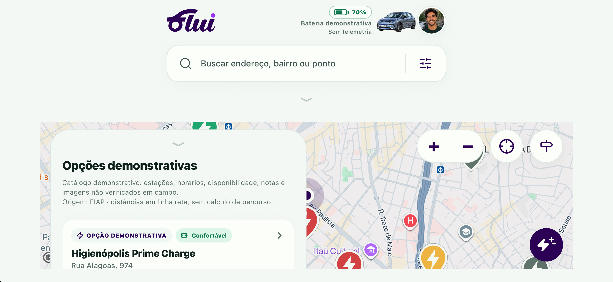
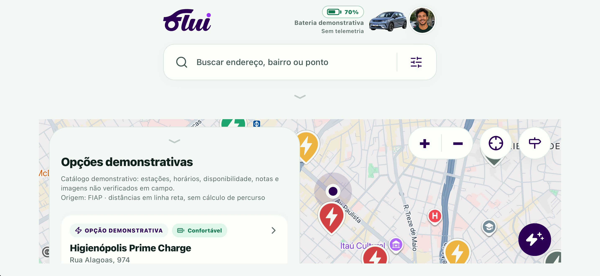

# PR #79 — atualização com main e foco horizontal

Rodada de 19/10/2026. `3b167f7` incorpora main `be859df` (PRs #88/#89 integradas), resolve a ficha reutilizando a combinação previamente validada e elimina a compensação vertical do painel lateral. Este complemento desloca a origem para fora da obstrução lateral, usando a largura medida do mapa e a largura do painel, inclusive ao reabrir o painel pelo controle de centralização. Retrato mantém a compensação anterior; nenhuma mudança de motor, estimativas ou dependências.

Arquivos do ajuste: `HomeMapScreen.tsx`, `mapLayout.ts`, `tests/responsividade.test.ts`. Conflito em `FluiAssistantSheet.tsx`: preservados voz, estados visíveis/acessíveis, corpo rolável, compositor fixo, fechamento e foco. Planejador recebido da main preservado.

## Checks

- Versão final: TypeScript, ESLint e **109 testes, 0 falhas**; exportação web de **12 rotas** concluída com a configuração de produção em portrait.
- Três testes novos cobrem supressão vertical em larguras 700/956/1194/1920, compensação de retrato/recolhimento/painel oculto/fallback/limite e deslocamento lateral apenas no layout horizontal.
- Quality de `3b167f7` aprovado: https://github.com/isalvesb/flui-charge-map-next/actions/runs/39348334060 . O Quality do complemento deve ser conferido no head desta PR, separadamente.

## Evidência iOS nova

Device Hub, iPhone 18 Pro Max, iOS 27.0, Expo Go, viewport horizontal **956 × 440 pt**. O usuário autorizou liberar rotação somente no bundle temporário. `app.config.js` foi restaurado byte a byte antes do commit; a configuração publicada permanece **portrait**.

1. XCTest de `3b167f7`: **1 teste, 0 falhas**. Após tocar Centralizar, marcador `(442,269,72,72)` e mapa `(62,190,832,230)` tinham ambos centro vertical em **305 pt**. Cinco controles acessíveis por toque e sem interseção. A captura integral mostrou que ainda havia obstrução parcial pela lateral — motivo do complemento.
2. Versão final: **conferência funcional direta pelo Device Hub aprovada**. Rotação temporária, toque no controle real de centralização e captura integral confirmaram o marcador totalmente fora do painel, sem retorno ao topo. Esta evidência é manual, não uma aprovação XCTest do complemento.
3. Regressão nativa da ficha após resolver o conflito em `3b167f7`: **1 XCTest, 0 falhas**, envio, botão de voz desativado, Respondendo → Pronta e fechamento. O complemento posterior só altera o mapa; a ficha permanece idêntica.

Etapa intermediária, ainda com obstrução lateral:

Resultado final, após tocar Centralizar no Device Hub:

## Limitações e rastreabilidade

A configuração de produção travada em retrato impediu o primeiro cenário horizontal. Uma tentativa posterior usou tipo de elemento acessível inadequado após rotação; a identificação pelo rótulo resolveu a medição. A execução XCTest do complemento ficou sem iniciar o cenário e foi interrompida após mais de dois minutos, substituída pela conferência direta no Device Hub; não é contada como teste aprovado. Resultados, logs e fonte completos ficam em `output/pr79-horizontal-20261019/` na área local da tarefa.

Capturas parciais do método XCUIApplication.screenshot após rotação apresentaram artefatos; as imagens publicadas são capturas integrais novas do simulador. Não se repetiram voz audível, VoiceOver, teclado, navegação em apps nativos ou toda a rodada antiga: nenhuma dessas funcionalidades foi modificada pelo complemento. Simulador/Expo Go não substituem aparelho físico ou binário de distribuição.

Nenhuma PR integrada, nenhuma main alterada diretamente, nenhum force push. Aprovação e integração continuam humanas.
