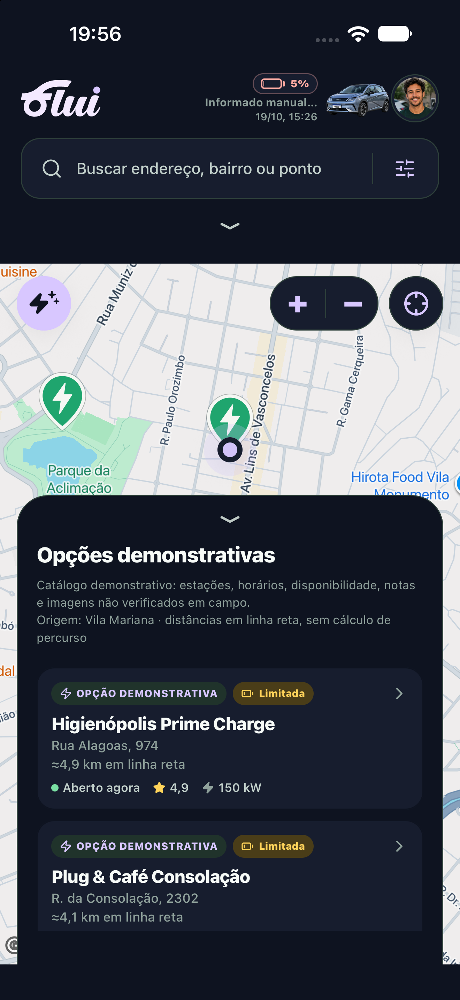

# Sprint final — PR #79, 19/10/2026

Main incorporada em `4b14a93`, com resolução de dois conflitos na ficha: corpo rolável/compositor fixo, fechamento e busca preservados; voz da main preservada. 91 testes, tipos/lint e Quality remoto aprovados nesse commit. PR continua draft, sem conflitos após a atualização.

Correção seguinte: o painel do mapa é remontado somente quando muda a escala de fonte, para recalcular os textos nativos após Dynamic Type em tempo de execução. Badges limitados à largura disponível, texto flexível e endereço multilinha. Mapa, região/zoom e motor da FluIA não são remontados nem alterados por essa correção.

91 testes, TypeScript e lint aprovados após o ajuste. Conferência visual nativa nova no iPhone 18 Pro Max, iOS 27.0, Expo Go: mudança Small → accessibility-medium durante a sessão agora apresenta aviso demonstrativo, nome e badges com quebra de linha, sem os recortes anteriormente registrados. O conteúdo maior excede a área visível e requer rolagem; isso não equivale a texto recortado dentro das linhas.

As evidências anteriores de teclado/envio/rolagem da FluIA continuam identificadas em `docs/validacao-pr79-20261019/`; não são declaradas novas. Não houve instalação de ferramentas ou alteração de dependências: reutilizada a expo-speech já preparada e declarada pela main. Duas tentativas locais de preparação do Metro falharam por resolução/cache da dependência; o cache derivado foi reconstruído e um bundle novo foi confirmado antes das capturas. O menu de controle do Device Hub ficou indisponível, sem impedir as capturas do simulador.

Discussões P2 das #88 e #89 verificadas e resolvidas, sem novo código: estado renderizado/acessível na #88; parada inalcançável bloqueada na #89. Reexecução dirigida: 3 testes de estado e 12 testes do planejador, todos aprovados. A aprovação humana prévia de voz e as limitações de Aviso/VoiceOver/apps nativos não foram transformadas em testes novos.

Nenhuma PR foi integrada, nenhuma main alterada diretamente e nenhum force push realizado. Logs/resultados completos em `output/sprint-final-20261019/` na área de trabalho da tarefa.
