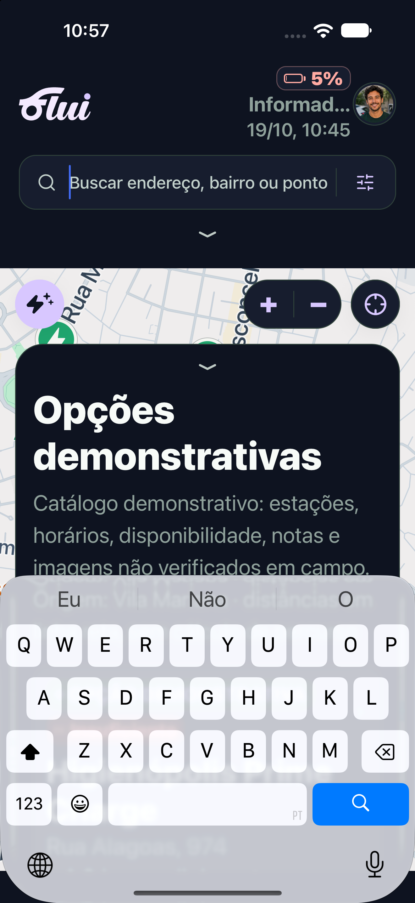
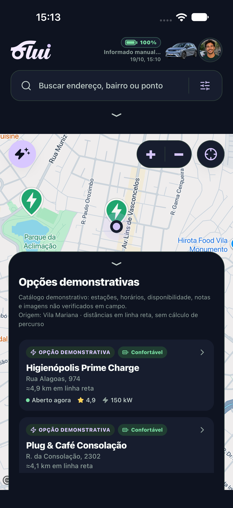
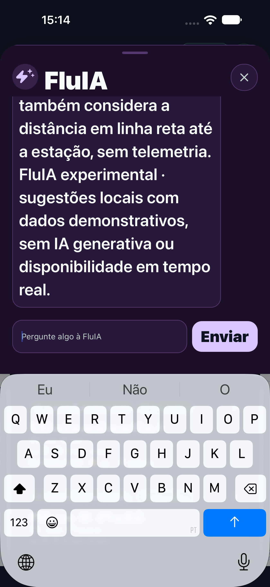
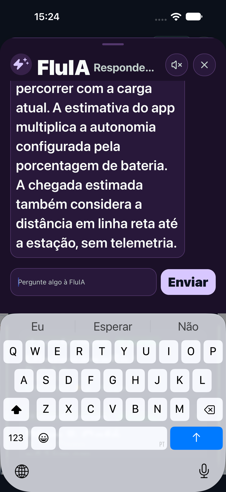
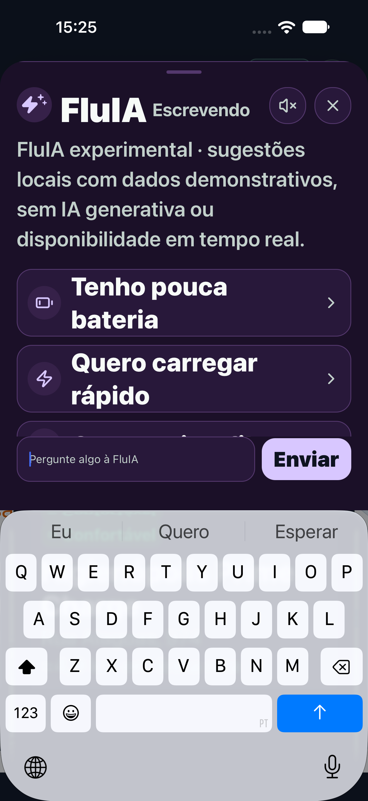
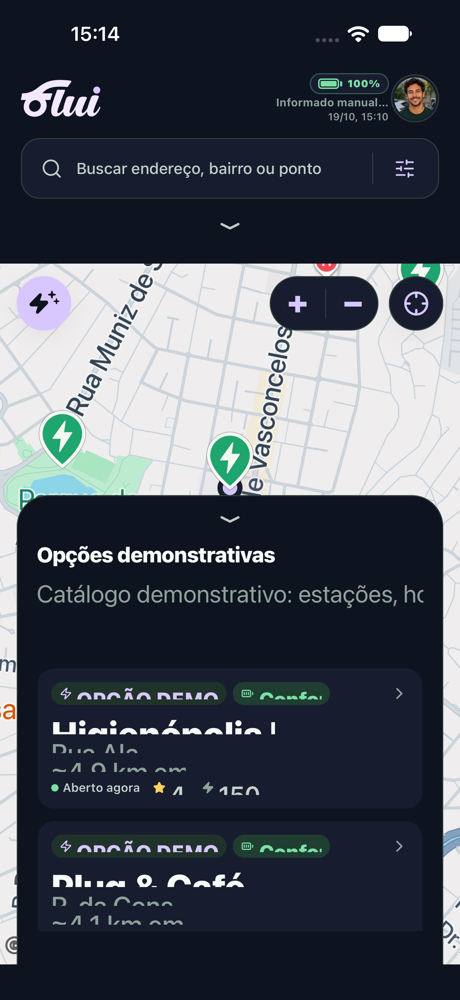

# PR #79 — foco da busca e validação iOS final

Código: `286c210`, sobre `99bd08d`. Branch local `fix/pr79-foco-fluia`, destino remoto `beta/responsividade-acessibilidade-2.6`. A PR permanece em rascunho.

## Defeito e correção

Buscar no mapa focado → abrir FluIA → focar mensagem → fechar restaurava o foco da busca e deixava o teclado sobre o mapa. A reprodução anterior está identificada como histórica, em `antes-historico-99bd08d.png`; não é comprovação da versão corrigida.

A mudança pontual em `src/features/map/HomeMapScreen.tsx` adiciona uma referência à busca e encerra explicitamente seu foco e o teclado antes de apresentar a FluIA. Cinco linhas adicionadas, sem mudanças no motor de respostas, na ficha da FluIA ou nas demais funcionalidades.

## Resultados novos individuais

`npm run check`: TypeScript e ESLint aprovados, **63 testes, 0 falhas**.

Device Hub, iPhone 18 Pro Max, iOS 27.0, 440 × 956 pt, Expo Go, Xcode 27.1; tema escuro e fonte interna maior. Sequência nativa executada com teclado virtual realmente visível (`y=653`, dentro da tela):

- Sistema Small: **1 XCTest, 0 falhas**.
- Sistema accessibility-medium: **1 XCTest, 0 falhas**.
- Busca focada antes de abrir, campo de mensagem, envio de autonomia, início e fim da resposta por rolagem, fechamento sem teclado residual, uso da busca depois, reabertura com conversa limpa, novo foco e fechamento aprovados nas duas escalas.
- Campo, Enviar e Fechar acessíveis acima do teclado. Retângulos dos controles do mapa sem interseção nos estados verificados. Não se afirma inspeção quadro a quadro de todas as animações.

## Combinação isolada das PRs #88, #89 e #79

Branch temporária `validacao/ios-pr88-pr89-pr79-20261019`, commit `64ca0c9`, base main `ab4959d`. Preservada a combinação anterior; aplicados os novos commits individuais sem conflitos. Essa branch não é publicada nas PRs originais.

TypeScript, lint, **106 testes** e exportação web (**12 rotas**) passaram. Após as correções novas: **3 XCTests, 0 falhas** — planejador/seletores, FluIA com texto normal e FluIA com texto ampliado. Os testes de chat incluem voz/estado no cabeçalho, teclado virtual, envio, rolagem início/fim, fechamento e reabertura. O teste do planejador confirma navegação mapa–planejador–mapa, reserva no destino e seletores individuais. Controles do mapa, incluindo Planejar viagem, sem interseção nos estados medidos.

## Limitação visual observada

Com accessibility-medium aplicado durante a sessão, textos/badges da lista de estações e o aviso demonstrativo no painel do mapa aparecem recortados dentro de seus espaços. A captura abaixo é nova. O teste geométrico dos botões do mapa não cobre essa legibilidade e não equivale a aprovação global de acessibilidade.

Esse comportamento não foi corrigido nesta alteração restrita ao foco; os estilos/lista não foram modificados. Causa e extensão não foram investigadas além da observação, para evitar ampliar a rodada. Deve ser avaliado na revisão humana da #79 antes de aprovação irrestrita.

Expo Go no simulador não substitui binário distribuído/iPhone físico. VoiceOver falado e navegação em Google Maps/Waze nativos não foram executados. Voz audível/interrupção da #88 já tinham aprovação humana informada em `945bb9e`, não foram repetidas como teste novo.

Logs, fonte XCTest e resultados completos locais em `output/finalizacao-prs-20261019/`: `pr79/Normal.xcresult`, `pr79/Ampliado.xcresult`, `integrada/FocoNormal.xcresult`, `integrada/FocoAmpliado.xcresult` e `integrada/PlanejadorNativo.xcresult`. Tentativas falhas de preparação do planejador estão preservadas e não contadas como aprovação.

Recomendação: correção de foco pronta para revisão; aprovação global da #79 condicionada à avaliação da limitação de texto ampliado. Nenhum merge realizado.
