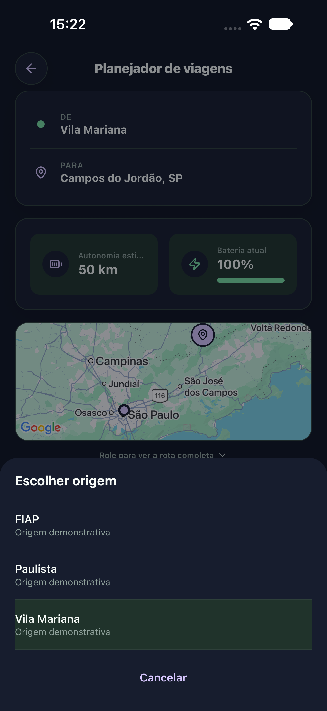
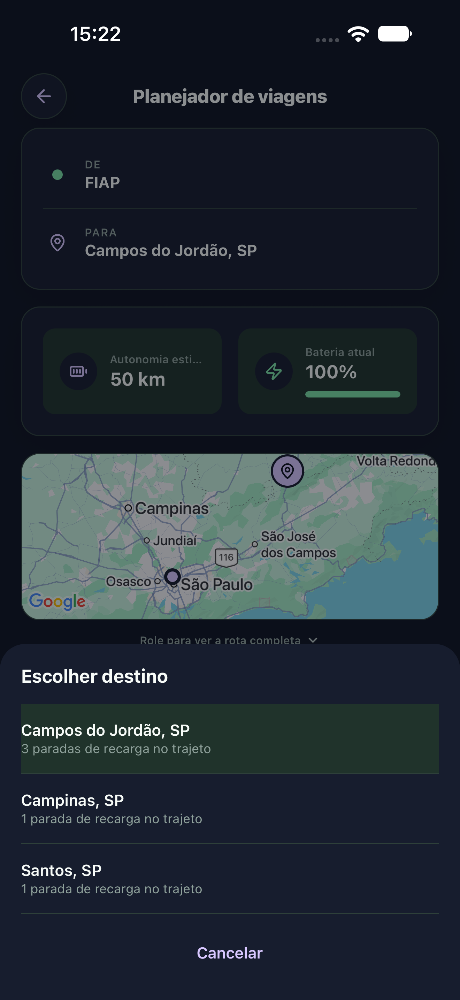
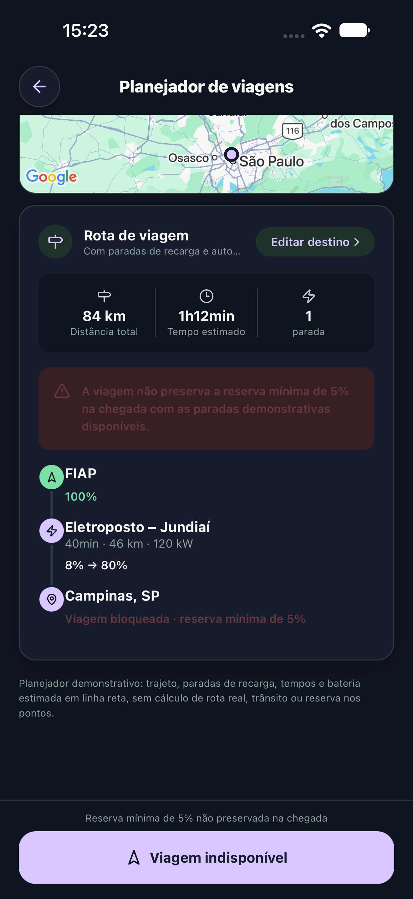
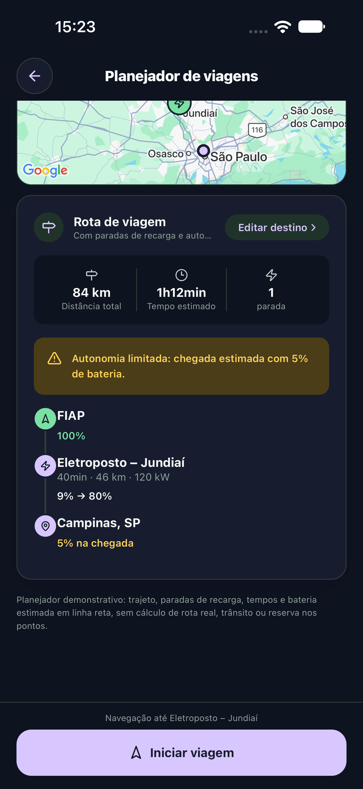

# PR #89 — fechamento das pendências de 19/10/2026

Código individual: `04c09fd`, sobre `4c2733a`. Branch local `fix/pr89-reserva-destino`; destino remoto `beta/planejador-de-viagens-2.4`.

## Correções

O trabalho humano nos três arquivos originais foi preservado, copiado antes da edição e revisado. O cálculo em `src/utils/tripPlanner.ts` permaneceu idêntico ao patch humano: exige 5% exatos no destino antes de arredondar; apresenta o resultado com piso. Não altera consumo, distâncias ou recarga de 80%.

Preservado o patch humano em `TripPlannerScreen.tsx`: fundo clicável irmão do conteúdo, opções acessíveis individualmente e indicação de seleção. Complementadas as mensagens de bloqueio para não prometer chegada quando a reserva falha. Em `TripPlannerScreen.styles.ts`, a porcentagem da parada passa a usar a cor do tema: o texto antes preto era pouco legível no tema escuro.

## Testes novos

`npm run check`: TypeScript e ESLint aprovados; **100 testes, 0 falhas**. Testes em `tests/tripPlanner.test.ts`: chegada de 4,6% bloqueada e exibida como 4%; exatamente 5% permitidos; valor imediatamente abaixo de 5% bloqueado; alternativa com recarga preservando 7% no destino. O teste humano de FIAP–Campinas com 50 km continua bloqueando chegada de 4%.

## iOS individual e combinado

Device Hub, iPhone 18 Pro Max, iOS 27.0, 440 × 956 pt, Expo Go, Xcode 27.1. Veículo Teste, bateria manual 100%, tema escuro, fonte interna maior, categoria de texto do sistema Small.

- Individual: **1 XCTest, 0 falhas**. Origem e destino acessíveis por botões individuais; FIAP/Campinas selecionados; seleção confirmada ao reabrir; Cancelar e fechamento pelo fundo funcionaram. Ida ao planejador e retorno ao mapa aprovados.
- FIAP → Campinas, 50 km: 84 km, parada em Jundiaí, 8% → 80%, destino 4%; avisos coerentes e botão Viagem indisponível desabilitado.
- Com 51 km: Jundiaí 9% → 80%, destino apresentado como 5%, Iniciar viagem habilitado. Esse valor nativo é arredondado para baixo; o caso exatamente 5% foi comprovado pelo teste unitário específico.
- A cor da porcentagem da parada foi corrigida depois do teste individual. Sua conferência visual nova e a repetição dos cenários acima passaram na **combinação isolada**, commit `64ca0c9`: **1 XCTest, 0 falhas**, 106 testes automatizados e exportação web de 12 rotas. Os quatro arquivos do planejador/teste são idênticos aos da branch individual. As capturas desta pasta são dessa execução combinada, incluindo a cor corrigida; não são apresentadas como capturas individuais.

## Limitações e rastreabilidade

Não se repetiu a abertura externa já registrada na rodada anterior. Google Maps e Waze nativos ausentes; não há aprovação de navegação nativa completa. Exposição na árvore acessível e acionamento de cada opção foram verificados; leitura falada por VoiceOver não foi executada. Não houve alteração de arquitetura/dependências nem merge.

Evidências completas locais: `output/finalizacao-prs-20261019/` no diretório de trabalho desta tarefa, incluindo backup `humano-pr89/`, logs `pr89/check-final.log`, `pr89/ios.log`, `pr89/Individual.xcresult`, `integrada/ios-planejador-nativo.log` e `integrada/PlanejadorNativo.xcresult`. Duas tentativas anteriores de preparação falharam no script (rótulo ambíguo e rolagem encoberta pelo teclado); a abordagem foi interrompida e substituída por preparação sem teclado virtual. Não são falhas de produto nem testes aprovados.

Aprovação do produto e merge continuam humanos.
